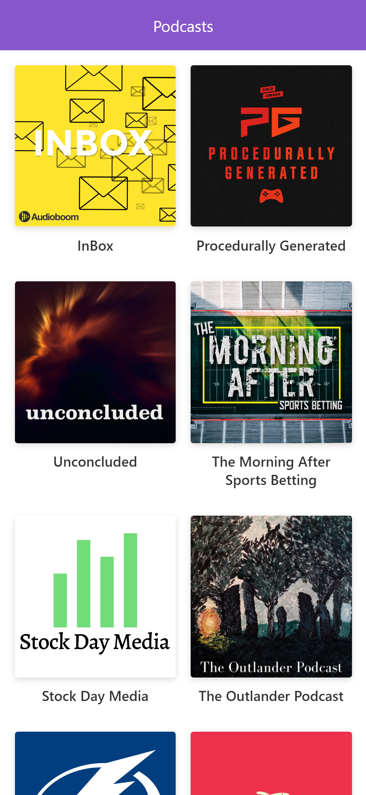

# App de Podcasts 

App de Podcasts integrada con la API de AudioBoom utilizando Next.JS

[Ver la página en linea](https://podcasts.pontzi.now.sh/)

## ¿Cómo funciona?

Requiere Node.JS 10
* `npm install` para instalar las dependencias.
* `npm run dev` para abrir entorno de desarrollo.
* `npm run build && npm start` para abrir entorno de producción.

## Licencia
MIT
